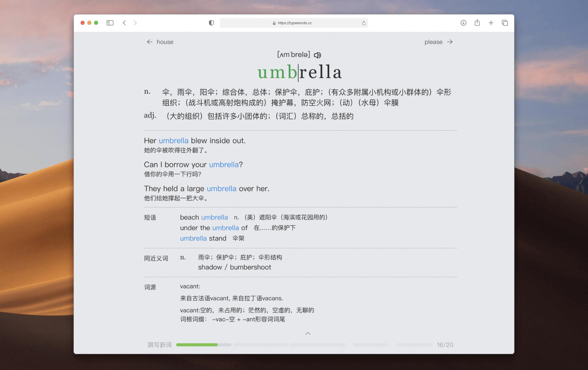

# TypeWords 安卓离线版

> 本仓库是开源项目 **[zyronon/TypeWords](https://github.com/zyronon/TypeWords)**（作者 [@zyronon](https://github.com/zyronon)，GPL-3.0 协议）的安卓离线打包版。
> 背单词、打字练习等功能全部来自原项目，这里只做了「装进手机、离线可用」的改造，同样以 GPL-3.0 协议开源。

## 下载

到 [Releases](https://github.com/geniusppl/TypeWords-Android/releases/latest) 下载最新的 `TypeWords-offline-*.apk`，在手机上安装即可。

## 和网页版的区别

- 用 Nuxt 纯前端模式（`TW_APP=1 pnpm generate`）+ Capacitor 打包成安卓 APP，所有页面都在手机本地运行
- 构建时把常用词典（`scripts/app/offline-dicts.txt`）和新概念英语 1–4 课文打进 APP；其余词典联网时按需下载并缓存到本机
- 没网时单词发音改用手机系统自带的 TTS 朗读
- 手机软键盘：输入法“组合输入”时也能逐字识别；键盘弹出时页面自动让位（adjustResize）
- 去掉了官网首页和小程序推广，打开直接进入单词练习

## 自己构建

```bash
pnpm install
./scripts/app/fetch-offline-dicts.sh
TW_APP=1 pnpm generate
npx cap sync android
cd android && ./gradlew assembleRelease
```

推送到 `main` 分支后，GitHub Actions（`.github/workflows/android.yml`）会自动构建签名 APK 并发布到 Releases。
签名用的是仓库里公开的测试密钥（`.github/signing/`），只为了保证每个版本可以覆盖安装。

---

以下为原项目说明：

<h1 align=center>
  
</h1>

<p align="center">
  <a href="/README.md">English</a> |
  <a href="/docs/README.es.md">Español</a> |
  <a href="/docs/README.de.md">Deutsch</a> |
  <a href="/docs/README.fr.md">Français</a> |
  <a href="/docs/README.pt.md">Português</a> |
  <a href="/docs/README.ru.md">Русский</a> |
  <a href="/docs/README.uk.md">Українська</a> |
  <a href="/docs/README.ja.md">日本語</a> |
  <a href="/docs/README.ko.md">한국인</a> |
  <a href="/docs/README.th.md">ไทย</a> |
  <a href="/docs/README.vi.md">Tiếng Việt</a> |
  <a href="/docs/README.id.md">Bahasa Indonesia</a> |
  <a href="/docs/README.zh-TW.md">繁體中文</a> |
  <a href="/docs/README.zh-CN.md">简体中文</a> 
</p>

<p align="center">
  <b>Learn English, one keystroke at a time; smarter memorization, more efficient learning - an open-source word and article practice tool</b>
</p>

## Project Introduction

<https://www.bilibili.com/video/BV1QwYv6eEAS>

## Online Access

<https://typewords.cc>




## Features

### Word Practice

- Practice modes: Follow-along / Dictation / Self-test / Spelling from memory
- Smart mode: Automatically calculates learning words based on memory curves, deepening memory through dictation
- Free mode: No restrictions, plan your own learning
- Provides phonetics, pronunciation (American/British), example sentences, phrases, synonyms, root words, etymology, error statistics, and more

### Article Memorization

- Built-in classic textbooks; you can also add or import articles with one-click translation and bilingual comparison
- Follow-along + dictation dual modes, sentence-by-sentence input with automatic pronunciation for more efficient memorization
- Supports listening while writing from memory to reinforce learning

### Favorites, Wrong Words, Mastered

- Words typed incorrectly while learning are automatically added to your wrong word book for later review
- Actively add words to mastered to automatically skip them in future sessions
- Add words to favorites for consolidation and review

### Highly Customizable

- Rich keyboard sound effects
- Customizable shortcuts
- Highly configurable settings

### Clean and Efficient

- Clean design, modern UI, ad-free
- Refreshing interface, simple operation
- No forced subscription to any platform

### Vocabulary Library

Built-in commonly used vocabulary including CET-4, CET-6, GMAT, GRE, IELTS, SAT, TOEFL, Graduate English, TEM-4, TEM-8, and more (official website only).
Designed to meet most users' vocabulary learning needs. Community contributions of additional vocabulary are welcome.

## Running the Project

#### Note: This project can run standalone with data saved locally. Manual backup is required when switching devices; this does not affect normal usage.

This project is built with `Nuxt` and requires a Node.js environment.

1. Install NodeJS, refer to the [official documentation](https://nodejs.org/en/download)
2. The project is large. It's recommended to use `git clone --depth 1 https://github.com/zyronon/TypeWords.git` to clone only the latest commit. GitHub's Download ZIP feature will not work properly.
3. In the project root directory, open a terminal and run `pnpm install` to download dependencies.
4. Run `pnpm run dev` to start the project. The default address is [`http://localhost:5567`](http://localhost:5567)
5. Open [`http://localhost:5567`](http://localhost:5567) in your browser to access the project.
6. Run `pnpm run generate` to build the project files.

## Features and Suggestions

The project is currently in early development, with new features being added continuously. If you have any suggestions or feature requests, feel free to open an `Issue`.
If you like the design philosophy of this software, please submit a `PR`. Thank you for your support!

## Contributing Guide

[Contributing Guidelines](/docs/CONTRIBUTING.md)

If you're interested in this project, we welcome your contributions and will provide as much help as possible.

Before contributing, please communicate with the developers to avoid code conflicts.

Thank you again for your contributions!


## ❤️ Support TypeWords
If TypeWords has been helpful to you, feel free to sponsor the project to support server operation and future development.  
Of course, sponsorship is not required for use—sharing the project, submitting feedback, or contributing code are also highly valuable forms of support.


